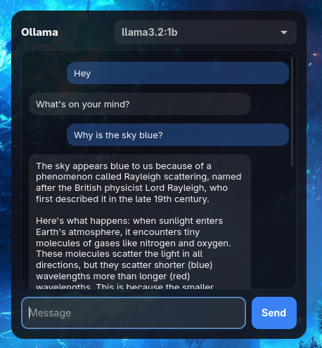

# Ollama chat

A desktop chat widget for a local Ollama server. It lists installed models,
keeps conversation history, and streams responses.

## How it works

- `GET /api/tags` provides the model list and tells the widget whether Ollama is
  available.
- The selected model and full conversation history are sent to `/api/chat` with
  `stream = true`.
- Each streamed JSON line is appended to the assistant message as it arrives.
- The model selector and input are hidden while Ollama is unavailable, and the
  widget retries automatically.

Requires Ollama and `curl`. Run with `nitroget -w examples/ollama`.
